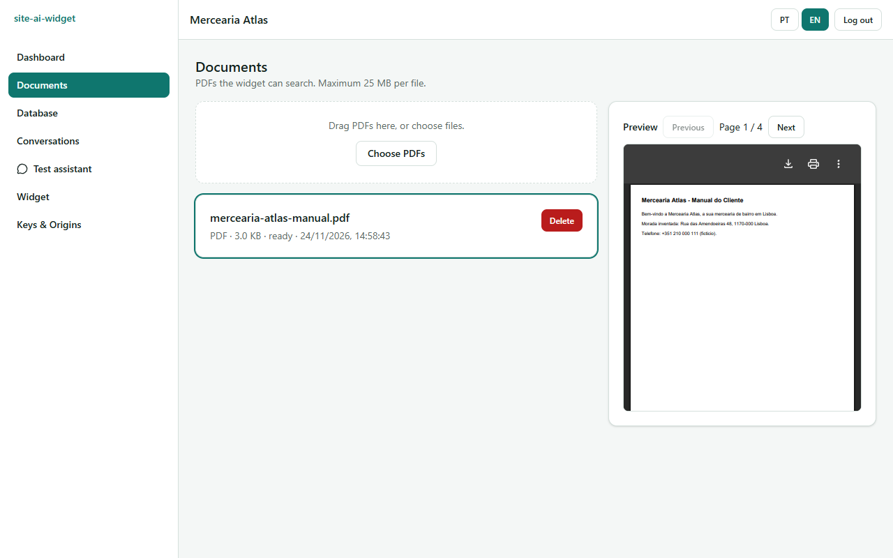
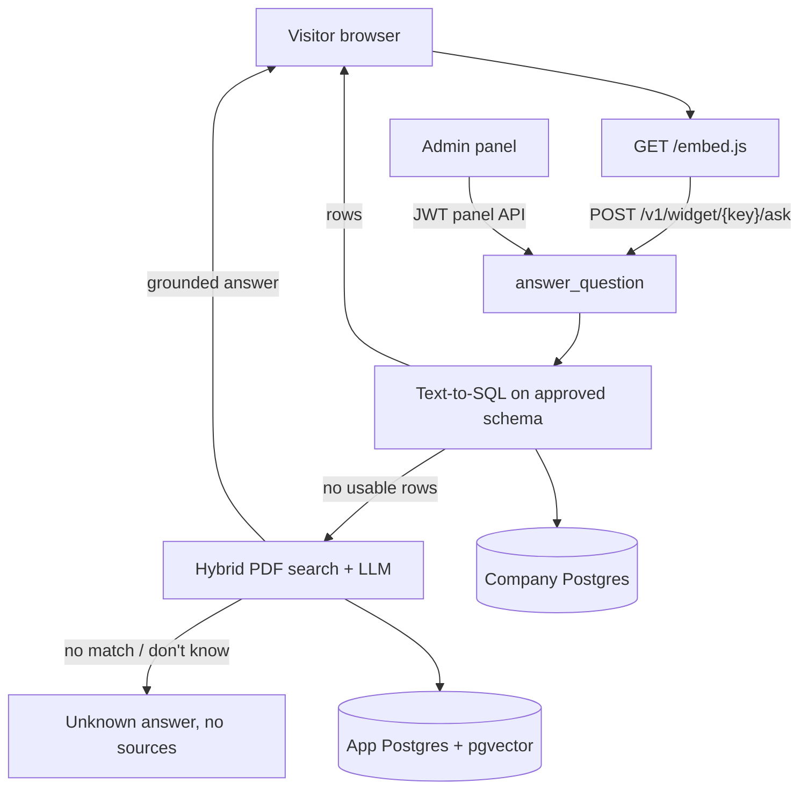

# site-ai-widget

**English** | [Português](README.pt.md)

**An AI assistant any company can embed on its website with one script tag: it answers visitors from the company's PDFs, with page citations, and from its own database through safe text-to-SQL — all managed from an admin panel.**

[](https://github.com/PedroPinho17/site-ai-widget/actions/workflows/tests.yml)


<p align="center">
  
</p>
<p align="center"><sub><a href="docs/media/demo.mp4">Full demo video — widget + admin panel (.mp4)</a></sub></p>

> All data is fictional (Mercearia Atlas and Oficina Lima, their PDF manuals and a demo client database). No real company, customer or person is represented.

## Overview

Small shops answer the same questions every day — prices, stock, opening hours, returns. The answers already exist, spread between **PDFs** (manuals, policies) and the **shop's own database**. This widget lets a company add an assistant to its site with one `<script>` tag. Each question goes **first to the database** (text-to-SQL on the tables the admin approved), **then to the documents** (hybrid search with page citations), and otherwise the assistant **says it doesn't know** instead of inventing an answer. Visitors can ask in **Portuguese or English**, and every company's data is isolated from the others.

## Key features

- **One script tag** — `embed.js` adds a floating chat in a closed Shadow DOM, with full screen, suggestion chips, clear chat and PT/EN copy.
- **Answers from the database, safely** — the LLM only sees tables and columns an admin approved; its SQL is validated with `sqlglot` and run in a read-only transaction with timeouts and a row limit. Sensitive columns (passwords, NIF, emails) can never be approved.
- **Answers from PDFs with page citations** — vector (local e5 embeddings, pgvector) + full-text search fused with RRF; citations only point to pages that were really retrieved, and visitors can open the cited page through a short-lived signed link.
- **No invented answers** — the SQL answer is checked so it cannot add numbers that are not in the rows; when nothing matches, the reply is "I don't know" with no sources.
- **Admin panel** (React + TypeScript) — dashboard, documents with preview, database connection and schema approval, conversations, a test assistant, widget look with colour picker, contrast check and live preview, keys and allowed origins. In Portuguese and English.
- **Multi-tenant by design** — `company_id` comes from the panel JWT or the widget key, never from the question; client database credentials are encrypted; each key only works on its allowed origins.

## Screenshots

<table>
  <tr>
    <td width="50%"><br><sub>Database answer: price question → safe text-to-SQL</sub></td>
    <td width="50%"><br><sub>Document answer with a page citation</sub></td>
  </tr>
  <tr>
    <td width="50%"><br><sub>Widget settings: colour picker and live preview</sub></td>
    <td width="50%"><br><sub>Conversations: each answer labelled by its source</sub></td>
  </tr>
</table>

<details>
<summary>More screenshots</summary>

<table>
  <tr>
    <td width="50%"><br><sub>Full-screen widget</sub></td>
    <td width="50%"><br><sub>Dashboard: usage and answer sources</sub></td>
  </tr>
  <tr>
    <td width="50%"><br><sub>Documents: upload and preview</sub></td>
    <td width="50%"><br><sub>Test assistant: try questions before going live</sub></td>
  </tr>
</table>

</details>

## Architecture



Request flow, language detection, schema retrieval, answer validation, multi-tenancy and the data model: **[docs/ARCHITECTURE.md](docs/ARCHITECTURE.md)**.

## Tech stack

| Area | Tools |
|---|---|
| Backend | Python 3.13, FastAPI, uv, psycopg 3 |
| Database | PostgreSQL 17, pgvector, full-text search, versioned SQL migrations |
| AI | Groq (OpenAI-compatible API, default `openai/gpt-oss-120b`), sqlglot, sentence-transformers (`intfloat/multilingual-e5-small`, local CPU) |
| Frontend | Panel: React 19, TypeScript, Vite, Tailwind CSS, TanStack Query · Widget: dependency-free JavaScript |
| Ops | Docker Compose, GitHub Actions |

The Groq **free tier** and the local e5 model are enough to run the demo; no paid cloud service is needed.

## Security

- **Tenant isolation** — `company_id` comes from the JWT or the widget key, never from the request body. Other companies' rows return **404**.
- **SQL runtime** — `SET TRANSACTION READ ONLY`, `statement_timeout` 5 s, lock timeout, named cursor, result cap of **500** rows / 1 MiB.
- **SQL validator** — sqlglot: a single read query, approved tables/columns only, comments stripped, hard `LIMIT` (default 100, max 500). Writes, DDL and unknown functions are refused.
- **Schema approval** — a column is usable only if **table and column** are approved. Sensitive names (e.g. password, NIF, email) cannot be approved.
- **Encrypted connections** — client DSNs are stored with Fernet (`CONNECTIONS_KEY`); the password is never returned by the API. A database outside `CLIENTDB_ALLOWED_HOSTS` is always reached with at least `sslmode=require`, so its password never travels in clear text.
- **Origins** — widget CORS only on `/v1/widget/*`; each key has an exact `scheme://host[:port]` allowlist.
- **Rate limits** — per IP for login, questions (each `/ask` weighs **3**), widget keys, widget lookups and the test assistant. Login is also limited per account (keyed by a hash of the email), so guessing a password from many IPs still hits a wall.
- **Closed sign-up** — `POST /auth/register` answers 404 unless `ALLOW_REGISTRATION=1`; the demo companies come from the seed.
- **Widget** — closed Shadow DOM, no `innerHTML` of model text, constructable stylesheets.
- **PDF links** — visitor links are HMAC-signed (`/v1/signed-documents/{id}`), 300 s by default (max 900 s), and only when the company turns `allow_visitor_documents` on.
- **Sessions** — the raw visitor token is returned once; only its SHA-256 is stored. Visitor sessions are deleted after the company's retention window (default 30 days, 1–365).
- **Response headers** — every API response has `nosniff`, `Referrer-Policy: no-referrer` (a signed PDF URL never leaks through `Referer`) and `frame-ancestors 'none'`; JSON also gets `default-src 'none'` and `Cache-Control: no-store`. The server version is not advertised.
- **Uploads** — PDF magic bytes, size and page limits, encrypted PDFs refused, and a cap on the text extracted from one file, so a crafted PDF cannot tie up the embedding CPU.

## Evaluation

40 hand-written questions about the fictional Mercearia Atlas (`eval/questions.json`), run end to end through the same code path as the widget.

**Latest full run (25 Nov 2026, Groq free tier): 29/40 correct (72.5%)**

| Type | Correct | What is checked |
|---|---|---|
| SQL | 15/20 | Same rows as the reference query (order, column names and up to 2 identifying extra columns ignored; numeric tolerance 0.01) |
| Documents | 11/15 | Answer contains the reference fact and cites the right page when it cites |
| Refusals | 3/5 | No SQL executed and an unknown/refusal answer |

The runner works in batches, waits and retries on Groq quota limits, saves a checkpoint and can resume. Run it inside the app container, so the stored client database host `clientdb` resolves:

```bash
docker compose up -d --build
docker compose exec app python -m site_ai_widget.evaluate --delay 0.5 --batch-size 5
docker compose exec app python -m site_ai_widget.evaluate --resume
```

The per-run report (`docs/evaluation.md`) and raw results (`eval/results/`) are generated locally and are not committed. Details: [docs/DEVELOPMENT.md](docs/DEVELOPMENT.md).

## Quick start

You need Docker, Node.js (for the panel) and a free [Groq API key](https://console.groq.com/keys).

```bash
cp .env.example .env              # fill in the variables below
cp panel/.env.example panel/.env  # VITE_API_URL, default http://127.0.0.1:8002
docker compose up -d --build      # app DB, demo client DB and API on 127.0.0.1:8002
```

Migrations run when the app starts. With `RUN_SEED=1` in `.env`, the demo companies and their PDFs are seeded too (or run `uv run site-ai-widget-seed` on the host).

Admin panel:

```bash
cd panel
npm install
npm run dev                       # http://127.0.0.1:5173
```

Demo shop page with the widget:

```bash
cd examples
python -m http.server 5500        # http://127.0.0.1:5500/demo-site.html
```

| Demo login | Company | Password |
|---|---|---|
| `admin@mercearia-atlas.example` | Mercearia Atlas (database + PDF) | `DEMO_PASSWORD_ATLAS` in your `.env` |
| `admin@oficina-lima.example` | Oficina Lima (PDF) | `DEMO_PASSWORD_LIMA` in your `.env` |

`GET http://127.0.0.1:8002/health` checks the API. `POSTGRES_PASSWORD` only applies when the `pgdata` volume is first created; changing it later needs `docker compose down -v`, which deletes local data.

Running tests, migrations, rebuilding and troubleshooting: [docs/DEVELOPMENT.md](docs/DEVELOPMENT.md).

## Widget embed

The public demo key is an embed id, not a password. The page's origin must be in the key's allowlist.

```html
<script
  src="http://127.0.0.1:8002/embed.js"
  data-key="wk_demo_mercearia_atlas"
  data-lang="pt"
  async
></script>
```

## Configuration

Set in `.env` (see [`.env.example`](.env.example)). Never commit real values.

| Variable | Purpose |
|---|---|
| `POSTGRES_PASSWORD`, `DATABASE_URL` | App database (host port 5435); same password in both |
| `JWT_SECRET` | Panel sessions; at least 32 random characters or the API refuses to start |
| `DEMO_PASSWORD_ATLAS`, `DEMO_PASSWORD_LIMA` | Demo panel logins (required to seed, no defaults) |
| `CLIENTDB_PASSWORD`, `ATLAS_READONLY_PASSWORD` | Demo client database (owner and read-only role) |
| `CONNECTIONS_KEY` | Fernet key that encrypts saved client DB connections |
| `CLIENTDB_ALLOWED_HOSTS` | Private `host:port` pairs the connection test may reach (locally `127.0.0.1:5436`; Compose sets `clientdb:5432` for the app) |
| `GROQ_API_KEY`, `GROQ_API_KEY_FALLBACK` | LLM key and an optional second key used on HTTP 429 / quota |
| `LLM_BASE_URL`, `LLM_MODEL`, `LLM_TIMEOUT_SECONDS` | Optional: any OpenAI-compatible endpoint |
| `PANEL_ORIGINS` | Admin panel origins allowed by CORS (never `*`) |
| `RUN_SEED` | `1` seeds the demo companies and PDFs on start |
| `ALLOW_REGISTRATION` | `1` opens self-service sign-up (`POST /auth/register`); default `0` |
| `TRUSTED_PROXY_IPS` | Optional proxy IPs/CIDRs allowed to set the client IP (default: loopback only) |
| `AUTH_RATE_LIMIT`, `API_RATE_LIMIT`, `ASK_RATE_LIMIT` (+ `_WINDOW`) | Optional rate limits |
| `MAX_UPLOAD_MB`, `MAX_PDF_PAGES`, `MAX_DOCUMENTS`, `MAX_QUESTION_CHARS` | Optional document and question limits |
| `APP_PORT`, `ENABLE_DOCS`, `JWT_HOURS`, `EMBEDDING_MODEL` | Optional runtime settings |

## Tests & CI

```bash
uv run ruff check .
uv run pytest tests/unit          # no LLM or network; database tests skip without Postgres
uv run pytest                     # + integration tests on a real PostgreSQL (docker compose up -d db)
cd panel && npm test && npm run typecheck && npm run lint
```

1,000+ Python tests cover the SQL validator against attack patterns, tenant isolation, signed PDF links, origins and rate limits, the widget API, the evaluation runner and more. 95 Vitest tests cover the panel.

[GitHub Actions](.github/workflows/tests.yml) runs ruff and the Python unit tests on every push and pull request, with no secrets.

## Roadmap

- Better document recall and refusal handling (the weakest areas in the evaluation).
- Shared rate limits (e.g. Redis) — they are kept in memory per process today.
- Panel checks (Vitest, typecheck, lint) in CI.
- A larger evaluation set, including Oficina Lima.

## Author

**Pedro Pinho** — [GitHub](https://github.com/PedroPinho17) · [LinkedIn](https://www.linkedin.com/in/pedropinho19/)

No open-source licence: all rights reserved.
