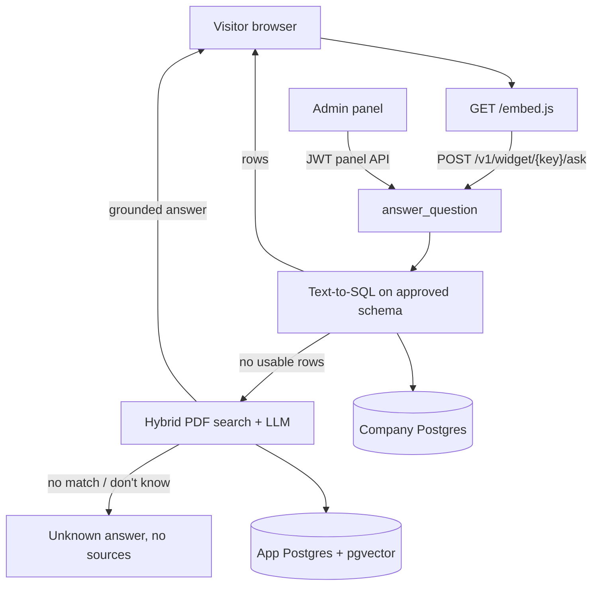

# site-ai-widget

[Português (PT)](README.pt.md)

Embeddable AI assistant for a company website. Visitors ask in a chat widget; answers come from **uploaded PDFs** (with page citations) and from the **company’s own database** through guarded text-to-SQL. Company staff use an **admin panel** (documents, schema approval, widget look, conversations, dashboard).

Demo data is fictional (Mercearia Atlas, Oficina Lima). There is no licence file.

**Author:** [Pedro Pinho](https://github.com/PedroPinho17) · [LinkedIn](https://www.linkedin.com/in/pedropinho19/)

## Stack

- **API:** Python 3.13, FastAPI, uv  
- **Store:** PostgreSQL 17 + pgvector (app DB)  
- **LLM:** Groq (OpenAI-compatible; default model `openai/gpt-oss-120b`)  
- **Embeddings:** local `intfloat/multilingual-e5-small` (Hugging Face, CPU)  
- **SQL:** sqlglot validator, read-only client session  
- **Panel:** Vite, React, TypeScript  
- **Widget:** `embed.js` (closed Shadow DOM)

The Groq **free tier** and the local e5 model are enough to run the demo. No paid cloud is required beyond that optional LLM.

## Architecture



## Features

- **Widget:** floating chat, optional full screen, PT/EN copy, colour + contrast, clear conversation, suggestion chips  
- **Documents:** PDF upload, hybrid search, page citations; optional short-lived signed PDF links for visitors  
- **Database:** save a read-only DSN, introspect, approve tables/columns, text-to-SQL  
- **Panel pages:** Dashboard, Documents, Database, Conversations, Test assistant, Widget, Keys & Origins  
- **i18n:** panel and widget in European Portuguese and English  
- **Suggestions:** cached questions from documents (admins can type their own)  
- **Retention:** visitor sessions deleted after the company’s window (default 30 days, 1–365)

## Quick start

Needs Docker, Node.js (for the panel), and Python 3.13 if you seed or test on the host.

1. Clone the repo and copy env templates. **Do not commit `.env`.** Fill your own values (never paste real production secrets into git):

   ```bash
   cp .env.example .env
   cp panel/.env.example panel/.env
   ```

   In `.env` set at least:

   - `JWT_SECRET` — at least 32 random characters (`uv run python -c "import secrets; print(secrets.token_urlsafe(32))"`)  
   - `POSTGRES_PASSWORD` and `DATABASE_URL` — same password in both; host port **5435**  
   - `DEMO_PASSWORD_ATLAS` and `DEMO_PASSWORD_LIMA` — demo panel logins (required to seed; **not stored in the repo**)  
   - `CLIENTDB_PASSWORD` and `ATLAS_READONLY_PASSWORD` — demo client Postgres  
   - `CONNECTIONS_KEY` — Fernet key (`uv run python -c "from cryptography.fernet import Fernet; print(Fernet.generate_key().decode())"`)  
   - `GROQ_API_KEY` — optional second key `GROQ_API_KEY_FALLBACK` for HTTP 429  
   - `CLIENTDB_ALLOWED_HOSTS` — locally `127.0.0.1:5436`; Compose already sets `clientdb:5432` for the **app** service  
   - `RUN_SEED=1` if you want Compose to seed Mercearia Atlas / Oficina Lima on start  

   `panel/.env` only needs `VITE_API_URL` (default `http://127.0.0.1:8002`).

2. Start the stack (app DB, demo client DB, API). Compose publishes the API on `127.0.0.1:8002` and Postgres on `127.0.0.1:5435` / `127.0.0.1:5436`:

   ```bash
   docker compose up -d --build
   ```

   Migrations run in the app entrypoint. With `RUN_SEED=1`, demo companies and PDFs are seeded there. You can also seed from the host: `uv run site-ai-widget-seed`.

3. Admin panel:

   ```bash
   cd panel
   npm install
   npm run dev
   ```

   Open `http://127.0.0.1:5173`. Demo emails (passwords are only what you put in `.env`):

   - `admin@mercearia-atlas.example`  
   - `admin@oficina-lima.example`

4. Demo shop page:

   ```bash
   cd examples
   python -m http.server 5500
   ```

   Open [http://127.0.0.1:5500/demo-site.html](http://127.0.0.1:5500/demo-site.html). Seeding Atlas allowlists `http://127.0.0.1:5500` on the public embed key.

`GET http://127.0.0.1:8002/health` checks the API.

`POSTGRES_PASSWORD` is applied only when the `pgdata` volume is first created. Changing it later in `.env` does not update Postgres; recreate volumes (`docker compose down -v`) only if you accept losing local data.

## Widget embed

Public demo key (embed id, not a password): `wk_demo_mercearia_atlas`.

```html
<script
  src="http://127.0.0.1:8002/embed.js"
  data-key="wk_demo_mercearia_atlas"
  data-lang="pt"
  async
></script>
```

The script is `GET /embed.js`. Origin must match the key’s allowlist exactly.

## Security

- **Tenancy:** `company_id` comes from the JWT or the widget key, never from the question body. Other companies’ rows return **404**.  
- **SQL runtime:** `SET TRANSACTION READ ONLY`, `statement_timeout` 5 s, lock timeout, named cursor, result cap **500** rows / 1 MiB.  
- **Validator:** sqlglot — single read query, approved tables/columns only, comments stripped, hard `LIMIT` (default 100, max 500). Writes, DDL and unknown functions are refused.  
- **Approval:** a column is usable only if **table and column** are `approved`. Sensitive names (e.g. password, NIF, email) cannot be approved.  
- **DSN:** stored with Fernet (`CONNECTIONS_KEY`); the password is never returned by the API.  
- **Origins:** widget CORS only on `/v1/widget/*`; allowlist is canonical `scheme://host[:port]`.  
- **Rate limits:** per-IP auth, ask (weight **3** per `/ask`), widget key, widget lookup, assistant test.  
- **Widget:** closed Shadow DOM, no `innerHTML` of model text, constructable stylesheets.  
- **PDFs:** visitor links are HMAC (`/v1/signed-documents/{id}`), default TTL 300 s, max 900 s, and only if `allow_visitor_documents` is on.  
- **Sessions:** raw visitor token returned once; only SHA-256 is stored.

## Evaluation

The evaluation set is `eval/questions.json` (40 fictional Atlas items). Runner: `uv run python -m site_ai_widget.evaluate`.

**Results: not run yet** (`docs/evaluation.md` is not in the repository).

## Docs

- [Architecture](docs/ARCHITECTURE.md)  
- [Development](docs/DEVELOPMENT.md)  
- [README in Portuguese](README.pt.md)
