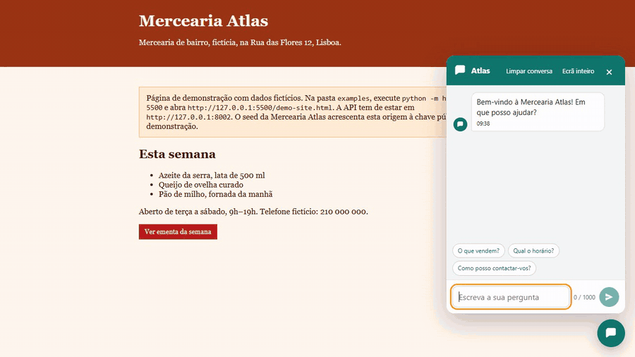
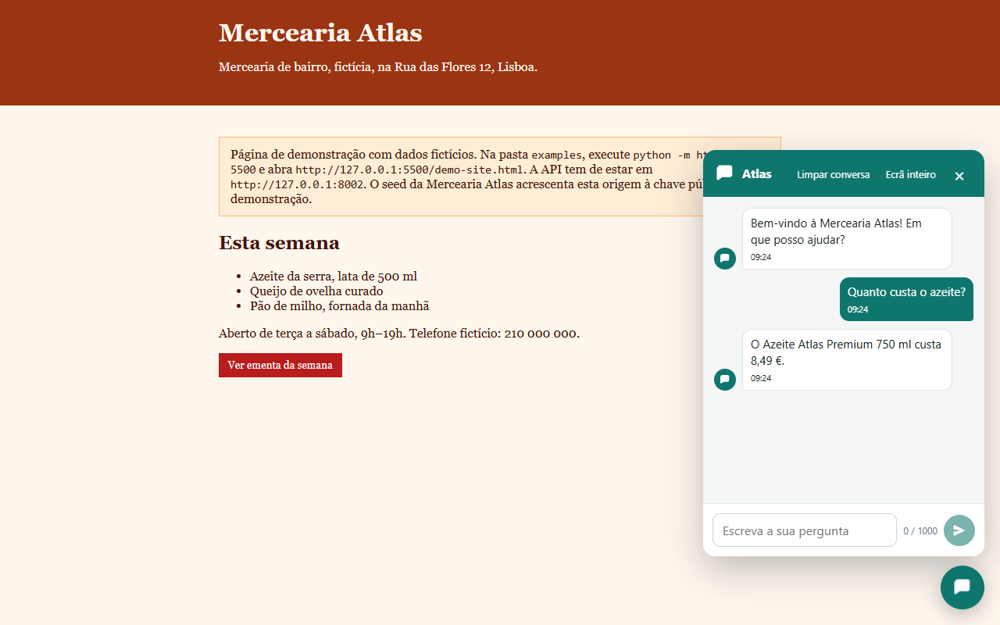
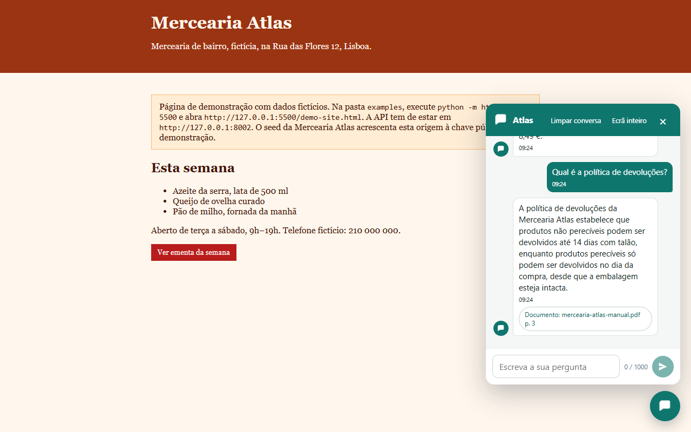
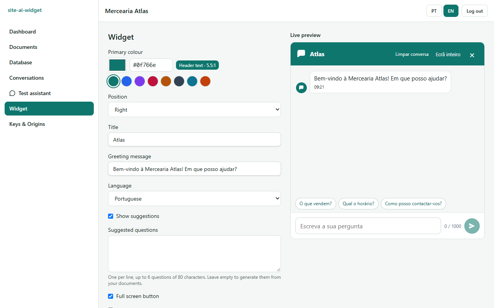
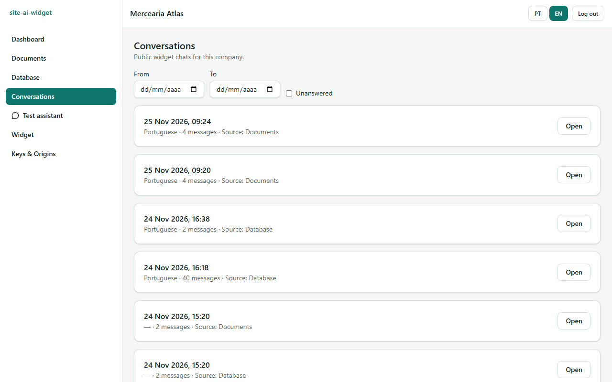
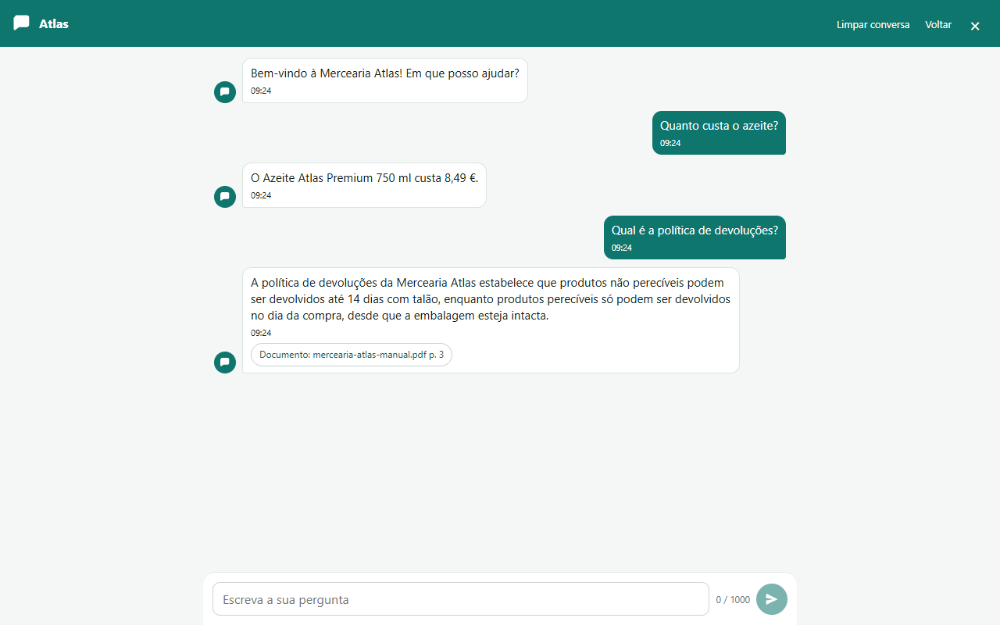
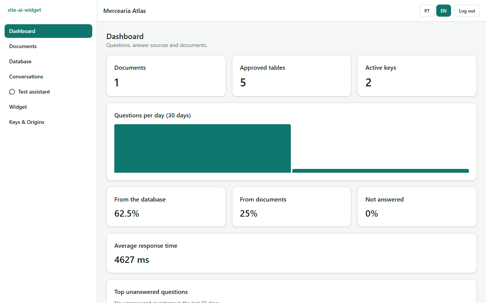
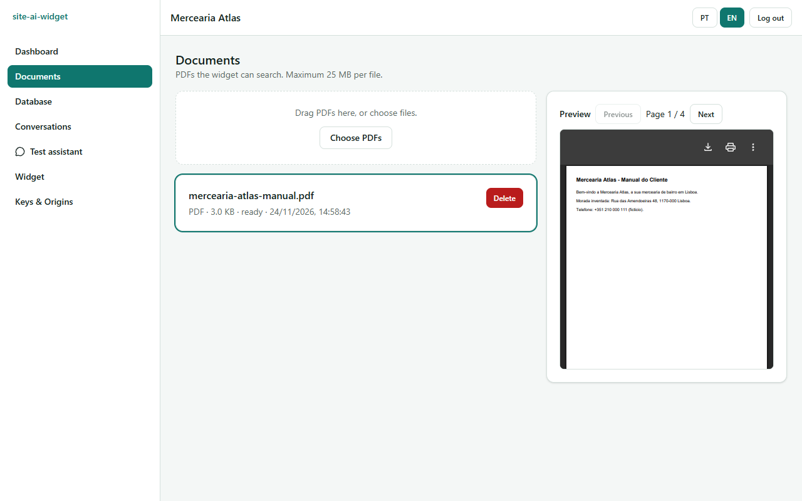
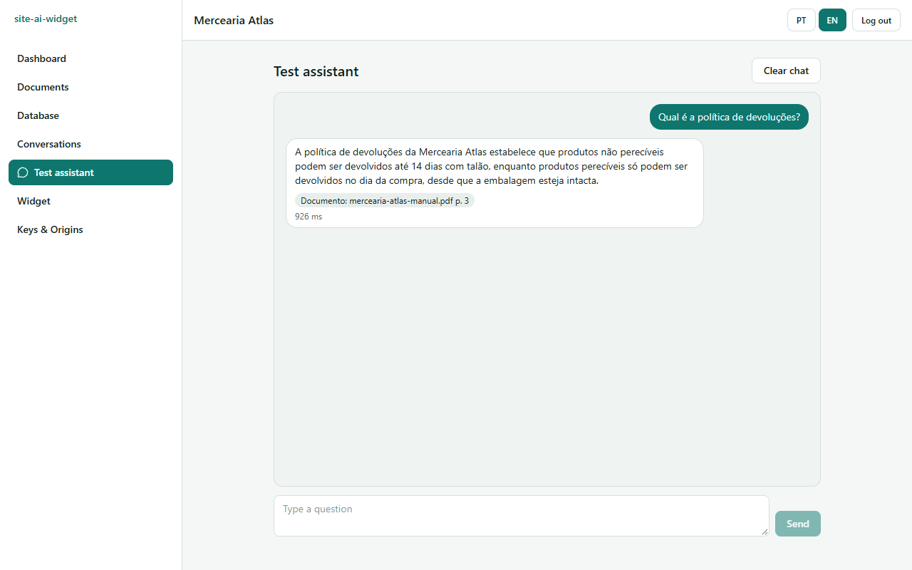
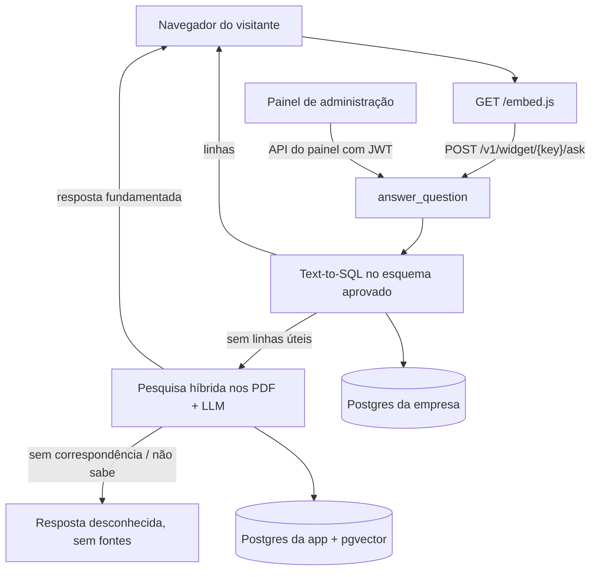

# site-ai-widget

[English](README.md) | **Português**

**Um assistente de IA que qualquer empresa pode pôr no seu sítio com uma única tag de script: responde aos visitantes a partir dos PDF da empresa, com citação da página, e da sua própria base de dados através de text-to-SQL seguro — tudo gerido num painel de administração.**

[](https://github.com/PedroPinho17/site-ai-widget/actions/workflows/tests.yml)


<p align="center">
  
</p>
<p align="center"><sub><a href="docs/media/demo.mp4">Vídeo completo da demonstração — widget + painel (.mp4)</a></sub></p>

> Todos os dados são fictícios (Mercearia Atlas e Oficina Lima, os respetivos manuais em PDF e uma base de dados de cliente de demonstração). Nenhuma empresa, cliente ou pessoa real está representada.

## Visão geral

As pequenas lojas respondem todos os dias às mesmas perguntas — preços, stock, horários, devoluções. As respostas já existem, repartidas entre **PDF** (manuais, políticas) e a **base de dados da própria loja**. Este widget permite a uma empresa acrescentar um assistente ao seu sítio com uma tag `<script>`. Cada pergunta vai **primeiro à base de dados** (text-to-SQL sobre as tabelas que o administrador aprovou), **depois aos documentos** (pesquisa híbrida com citação da página) e, se nada servir, o assistente **diz que não sabe** em vez de inventar uma resposta. Os visitantes podem perguntar em **português ou inglês**, e os dados de cada empresa estão isolados dos das outras.

## Funcionalidades principais

- **Uma tag de script** — o `embed.js` acrescenta um chat flutuante num Shadow DOM fechado, com ecrã inteiro, sugestões, limpar conversa e textos em PT/EN.
- **Respostas da base de dados, com segurança** — o LLM só vê as tabelas e colunas que um administrador aprovou; o SQL é validado com `sqlglot` e executado numa transação só de leitura, com tempos limite e limite de linhas. Colunas sensíveis (palavras-passe, NIF, emails) nunca podem ser aprovadas.
- **Respostas dos PDF com citação da página** — pesquisa vetorial (embeddings e5 locais, pgvector) + full-text, combinadas com RRF; as citações só apontam para páginas realmente encontradas, e o visitante pode abrir a página citada através de uma ligação assinada de curta duração.
- **Sem respostas inventadas** — a resposta do SQL é verificada para não acrescentar números que não estão nas linhas; quando nada corresponde, a resposta é «não sei», sem fontes.
- **Painel de administração** (React + TypeScript) — dashboard, documentos com pré-visualização, ligação à base de dados e aprovação do esquema, conversas, testar assistente, aspeto do widget com seletor de cor, verificação de contraste e pré-visualização ao vivo, chaves e origens permitidas. Em português e inglês.
- **Multiempresa de raiz** — o `company_id` vem do JWT do painel ou da chave do widget, nunca da pergunta; as credenciais das bases de dados dos clientes são cifradas; cada chave só funciona nas origens permitidas.

## Capturas de ecrã

<table>
  <tr>
    <td width="50%"><br><sub>Resposta da base de dados: pergunta de preço → text-to-SQL seguro</sub></td>
    <td width="50%"><br><sub>Resposta de documento com citação da página</sub></td>
  </tr>
  <tr>
    <td width="50%"><br><sub>Definições do widget: seletor de cor e pré-visualização ao vivo</sub></td>
    <td width="50%"><br><sub>Conversas: cada resposta identificada pela origem</sub></td>
  </tr>
</table>

<details>
<summary>Mais capturas</summary>

<table>
  <tr>
    <td width="50%"><br><sub>Widget em ecrã inteiro</sub></td>
    <td width="50%"><br><sub>Dashboard: utilização e origem das respostas</sub></td>
  </tr>
  <tr>
    <td width="50%"><br><sub>Documentos: carregar e pré-visualizar</sub></td>
    <td width="50%"><br><sub>Testar assistente: experimentar perguntas antes de publicar</sub></td>
  </tr>
</table>

As capturas do painel estão em inglês; o painel também está disponível em português.

</details>

## Arquitetura



Fluxo de um pedido, deteção de idioma, seleção do esquema, validação das respostas, multiempresa e modelo de dados: **[docs/ARCHITECTURE.md](docs/ARCHITECTURE.md)** (em inglês).

## Tecnologias

| Área | Ferramentas |
|---|---|
| Backend | Python 3.13, FastAPI, uv, psycopg 3 |
| Base de dados | PostgreSQL 17, pgvector, pesquisa full-text, migrações SQL versionadas |
| IA | Groq (API compatível com OpenAI, modelo por omissão `openai/gpt-oss-120b`), sqlglot, sentence-transformers (`intfloat/multilingual-e5-small`, CPU local) |
| Frontend | Painel: React 19, TypeScript, Vite, Tailwind CSS, TanStack Query · Widget: JavaScript sem dependências |
| Operações | Docker Compose, GitHub Actions |

O **plano gratuito** da Groq e o modelo e5 local chegam para correr a demonstração; não é preciso nenhum serviço pago na nuvem.

## Segurança

- **Isolamento entre empresas** — o `company_id` vem do JWT ou da chave do widget, nunca do corpo do pedido. Linhas de outras empresas devolvem **404**.
- **Execução do SQL** — `SET TRANSACTION READ ONLY`, `statement_timeout` de 5 s, tempo limite de bloqueio, cursor com nome, máximo de **500** linhas / 1 MiB.
- **Validador de SQL** — sqlglot: uma única consulta de leitura, só tabelas/colunas aprovadas, comentários removidos, `LIMIT` obrigatório (100 por omissão, máximo 500). Escritas, DDL e funções desconhecidas são recusadas.
- **Aprovação do esquema** — uma coluna só pode ser usada se a **tabela e a coluna** estiverem aprovadas. Nomes sensíveis (p. ex. password, NIF, email) não podem ser aprovados.
- **Ligações cifradas** — os DSN dos clientes são guardados com Fernet (`CONNECTIONS_KEY`); a palavra-passe nunca é devolvida pela API. Uma base de dados fora de `CLIENTDB_ALLOWED_HOSTS` é sempre contactada com pelo menos `sslmode=require`, para a palavra-passe nunca circular em texto simples.
- **Origens** — CORS do widget só em `/v1/widget/*`; cada chave tem uma lista exata de `scheme://host[:port]` permitidos.
- **Limites de pedidos** — por IP no login, nas perguntas (cada `/ask` conta **3**), nas chaves do widget, nas consultas do widget e em testar assistente. O login também tem limite por conta (com um hash do email), por isso tentar adivinhar uma palavra-passe a partir de muitos IP continua a ser travado.
- **Registo fechado** — `POST /auth/register` responde 404 a menos que `ALLOW_REGISTRATION=1`; as empresas de demonstração vêm do seed.
- **Widget** — Shadow DOM fechado, sem `innerHTML` com texto do modelo, folhas de estilo construídas.
- **Ligações para PDF** — as ligações para visitantes são assinadas com HMAC (`/v1/signed-documents/{id}`), 300 s por omissão (máximo 900 s), e só quando a empresa ativa `allow_visitor_documents`.
- **Sessões** — o token do visitante é devolvido uma vez; só se guarda o SHA-256. As sessões dos visitantes são apagadas no fim do período de retenção da empresa (30 dias por omissão, 1–365).
- **Cabeçalhos de resposta** — todas as respostas da API têm `nosniff`, `Referrer-Policy: no-referrer` (um URL assinado de PDF nunca sai pelo `Referer`) e `frame-ancestors 'none'`; o JSON tem ainda `default-src 'none'` e `Cache-Control: no-store`. A versão do servidor não é anunciada.
- **Carregamentos** — assinatura `%PDF-`, limites de tamanho e de páginas, PDF cifrados recusados e um limite ao texto extraído de cada ficheiro, para um PDF malicioso não prender o CPU dos embeddings.

## Avaliação

40 perguntas escritas à mão sobre a Mercearia Atlas fictícia (`eval/questions.json`), executadas de ponta a ponta pelo mesmo código do widget.

**Última avaliação completa (25 nov. 2026, plano gratuito da Groq): 29/40 corretas (72,5%)**

| Tipo | Corretas | O que se verifica |
|---|---|---|
| SQL | 15/20 | As mesmas linhas da consulta de referência (ignora a ordem, os nomes das colunas e até 2 colunas extra de identificação; tolerância numérica de 0,01) |
| Documentos | 11/15 | A resposta contém o facto de referência e cita a página certa quando cita |
| Recusas | 3/5 | Nenhum SQL executado e uma resposta de recusa/desconhecida |

A avaliação corre em lotes, espera e repete quando atinge os limites de quota da Groq, guarda um checkpoint e pode ser retomada. Corra-a dentro do contentor da app, para o anfitrião `clientdb` da base de dados do cliente resolver:

```bash
docker compose up -d --build
docker compose exec app python -m site_ai_widget.evaluate --delay 0.5 --batch-size 5
docker compose exec app python -m site_ai_widget.evaluate --resume
```

O relatório de cada execução (`docs/evaluation.md`) e os resultados brutos (`eval/results/`) são gerados localmente e não entram no repositório. Detalhes: [docs/DEVELOPMENT.md](docs/DEVELOPMENT.md) (em inglês).

## Arranque rápido

Precisa de Docker, Node.js (para o painel) e de uma [chave da API da Groq](https://console.groq.com/keys) gratuita.

```bash
cp .env.example .env              # preencha as variáveis abaixo
cp panel/.env.example panel/.env  # VITE_API_URL, por omissão http://127.0.0.1:8002
docker compose up -d --build      # BD da app, BD de cliente de demonstração e API em 127.0.0.1:8002
```

As migrações correm quando a app arranca. Com `RUN_SEED=1` no `.env`, as empresas de demonstração e os respetivos PDF também são criados (ou corra `uv run site-ai-widget-seed` no anfitrião).

Painel de administração:

```bash
cd panel
npm install
npm run dev                       # http://127.0.0.1:5173
```

Página da loja de demonstração com o widget:

```bash
cd examples
python -m http.server 5500        # http://127.0.0.1:5500/demo-site.html
```

| Login de demonstração | Empresa | Palavra-passe |
|---|---|---|
| `admin@mercearia-atlas.example` | Mercearia Atlas (base de dados + PDF) | `DEMO_PASSWORD_ATLAS` no seu `.env` |
| `admin@oficina-lima.example` | Oficina Lima (PDF) | `DEMO_PASSWORD_LIMA` no seu `.env` |

`GET http://127.0.0.1:8002/health` verifica a API. O `POSTGRES_PASSWORD` só se aplica quando o volume `pgdata` é criado pela primeira vez; mudá-lo depois obriga a `docker compose down -v`, que apaga os dados locais.

Testes, migrações, reconstrução e resolução de problemas: [docs/DEVELOPMENT.md](docs/DEVELOPMENT.md) (em inglês).

## Incorporar o widget

A chave pública de demonstração é um identificador, não uma palavra-passe. A origem da página tem de estar na lista permitida da chave.

```html
<script
  src="http://127.0.0.1:8002/embed.js"
  data-key="wk_demo_mercearia_atlas"
  data-lang="pt"
  async
></script>
```

## Configuração

Definida no `.env` (ver [`.env.example`](.env.example)). Nunca faça commit de valores reais.

| Variável | Para que serve |
|---|---|
| `POSTGRES_PASSWORD`, `DATABASE_URL` | Base de dados da app (porta 5435 no anfitrião); a mesma palavra-passe nas duas |
| `JWT_SECRET` | Sessões do painel; pelo menos 32 caracteres aleatórios, senão a API não arranca |
| `DEMO_PASSWORD_ATLAS`, `DEMO_PASSWORD_LIMA` | Logins de demonstração do painel (obrigatórios para o seed, sem valores por omissão) |
| `CLIENTDB_PASSWORD`, `ATLAS_READONLY_PASSWORD` | Base de dados de cliente de demonstração (dono e role só de leitura) |
| `CONNECTIONS_KEY` | Chave Fernet que cifra as ligações guardadas às bases de dados dos clientes |
| `CLIENTDB_ALLOWED_HOSTS` | Pares `host:porta` privados que o teste de ligação pode alcançar (localmente `127.0.0.1:5436`; o Compose define `clientdb:5432` para a app) |
| `GROQ_API_KEY`, `GROQ_API_KEY_FALLBACK` | Chave do LLM e uma segunda chave opcional usada em HTTP 429 / quota |
| `LLM_BASE_URL`, `LLM_MODEL`, `LLM_TIMEOUT_SECONDS` | Opcional: qualquer endpoint compatível com OpenAI |
| `PANEL_ORIGINS` | Origens do painel permitidas pelo CORS (nunca `*`) |
| `RUN_SEED` | `1` cria as empresas e os PDF de demonstração no arranque |
| `ALLOW_REGISTRATION` | `1` abre o registo livre (`POST /auth/register`); por omissão `0` |
| `TRUSTED_PROXY_IPS` | IP/CIDR opcionais de proxies que podem indicar o IP do cliente (por omissão: só loopback) |
| `AUTH_RATE_LIMIT`, `API_RATE_LIMIT`, `ASK_RATE_LIMIT` (+ `_WINDOW`) | Limites de pedidos opcionais |
| `MAX_UPLOAD_MB`, `MAX_PDF_PAGES`, `MAX_DOCUMENTS`, `MAX_QUESTION_CHARS` | Limites opcionais de documentos e perguntas |
| `APP_PORT`, `ENABLE_DOCS`, `JWT_HOURS`, `EMBEDDING_MODEL` | Definições opcionais de execução |

## Testes e CI

```bash
uv run ruff check .
uv run pytest tests/unit          # sem LLM nem rede; os testes de base de dados são ignorados sem Postgres
uv run pytest                     # + testes de integração num PostgreSQL real (docker compose up -d db)
cd panel && npm test && npm run typecheck && npm run lint
```

Mais de 1000 testes Python cobrem o validador de SQL contra padrões de ataque, o isolamento entre empresas, as ligações assinadas para PDF, as origens e os limites de pedidos, a API do widget, o executor da avaliação e mais. 95 testes Vitest cobrem o painel.

O [GitHub Actions](.github/workflows/tests.yml) corre o ruff e os testes unitários Python em cada push e pull request, sem segredos.

## Próximos passos

- Melhor recuperação nos documentos e melhor tratamento das recusas (as áreas mais fracas na avaliação).
- Limites de pedidos partilhados (p. ex. Redis) — hoje ficam em memória, por processo.
- Verificações do painel (Vitest, typecheck, lint) no CI.
- Um conjunto de avaliação maior, incluindo a Oficina Lima.

## Autor

**Pedro Pinho** — [GitHub](https://github.com/PedroPinho17) · [LinkedIn](https://www.linkedin.com/in/pedropinho19/)

Sem licença open source: todos os direitos reservados.
