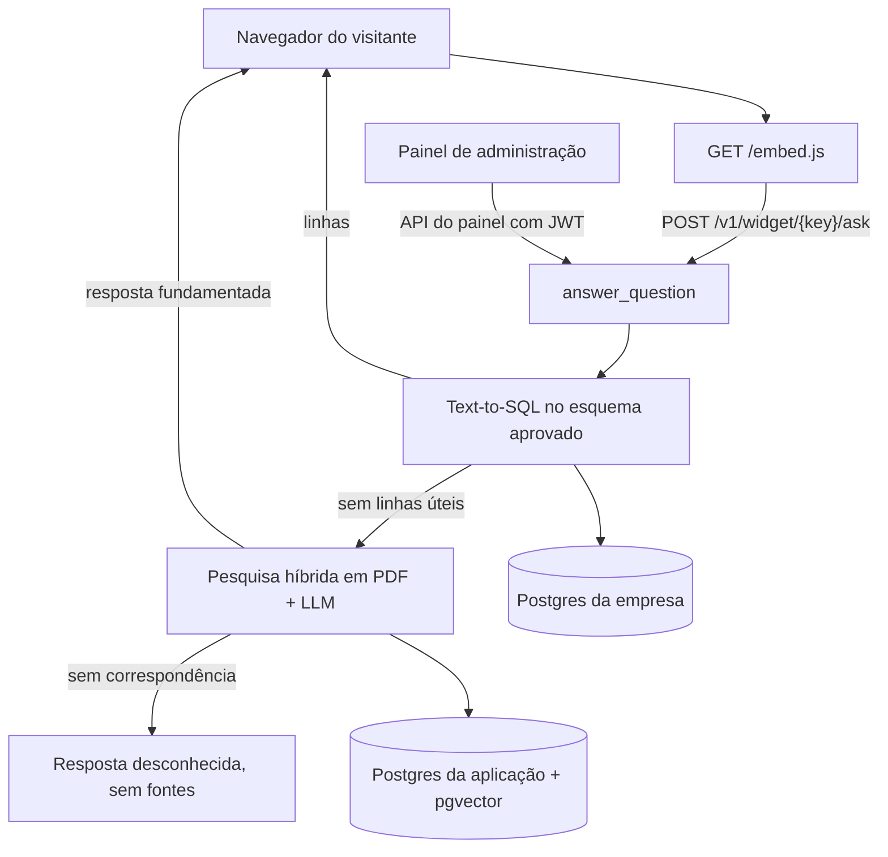

# site-ai-widget

[English](README.md)

Assistente de IA incorporável no sítio de uma empresa. O visitante pergunta num widget de chat; as respostas vêm de **PDF carregados** (com citação da página) e da **base de dados da empresa**, através de text-to-SQL controlado. A equipa usa um **painel de administração** (documentos, aprovação do esquema, aspeto do widget, conversas, dashboard).

Os dados de demonstração são fictícios (Mercearia Atlas, Oficina Lima). Não há ficheiro de licença.

**Autor:** [Pedro Pinho](https://github.com/PedroPinho17) · [LinkedIn](https://www.linkedin.com/in/pedropinho19/)

## Stack

- **API:** Python 3.13, FastAPI, uv  
- **Armazenamento:** PostgreSQL 17 + pgvector (base da aplicação)  
- **LLM:** Groq (compatível com OpenAI; modelo predefinido `openai/gpt-oss-120b`)  
- **Embeddings:** `intfloat/multilingual-e5-small` local (Hugging Face, CPU)  
- **SQL:** validador sqlglot, sessão de cliente só de leitura  
- **Painel:** Vite, React, TypeScript  
- **Widget:** `embed.js` (Shadow DOM fechado)

O escalão gratuito da Groq e o modelo e5 local chegam para correr a demo. Não é obrigatório outro serviço pago.

## Arquitetura



## Funcionalidades

- **Widget:** chat flutuante, ecrã inteiro opcional, textos PT/EN, cor e contraste, limpar conversa, sugestões  
- **Documentos:** carregamento de PDF, pesquisa híbrida, citações de página; ligações assinadas de curta duração para o visitante (opcional)  
- **Base de dados:** DSN só de leitura, introspeção, aprovação de tabelas/colunas, text-to-SQL  
- **Páginas do painel:** Dashboard, Documentos, Base de dados, Conversas, Testar assistente, Widget, Chaves e origens  
- **i18n:** painel e widget em português europeu e inglês  
- **Sugestões:** perguntas geradas a partir dos documentos (o administrador pode escrever as suas)  
- **Retenção:** sessões de visitante apagadas após a janela da empresa (predefinição 30 dias, 1–365)

## Arranque rápido

É preciso Docker, Node.js (painel) e Python 3.13 se for semear ou testar no anfitrião.

1. Clone o repositório e copie os exemplos de ambiente. **Não faça commit do `.env`.** Preencha valores seus (nunca coloque segredos reais no git):

   ```bash
   cp .env.example .env
   cp panel/.env.example panel/.env
   ```

   No `.env` defina pelo menos:

   - `JWT_SECRET` — no mínimo 32 caracteres aleatórios (`uv run python -c "import secrets; print(secrets.token_urlsafe(32))"`)  
   - `POSTGRES_PASSWORD` e `DATABASE_URL` — a mesma palavra-passe nos dois; porto **5435**  
   - `DEMO_PASSWORD_ATLAS` e `DEMO_PASSWORD_LIMA` — acessos de demo ao painel (obrigatórios para o seed; **não estão no repositório**)  
   - `CLIENTDB_PASSWORD` e `ATLAS_READONLY_PASSWORD` — Postgres de cliente de demo  
   - `CONNECTIONS_KEY` — chave Fernet (`uv run python -c "from cryptography.fernet import Fernet; print(Fernet.generate_key().decode())"`)  
   - `GROQ_API_KEY` — segunda chave opcional `GROQ_API_KEY_FALLBACK` para HTTP 429  
   - `CLIENTDB_ALLOWED_HOSTS` — em local `127.0.0.1:5436`; o Compose já define `clientdb:5432` no serviço **app**  
   - `RUN_SEED=1` se quiser que o Compose semeie a Mercearia Atlas / Oficina Lima ao arrancar  

   Em `panel/.env` basta `VITE_API_URL` (predefinição `http://127.0.0.1:8002`).

2. Subir a stack (base da aplicação, base de cliente de demo, API). O Compose publica a API em `127.0.0.1:8002` e o Postgres em `127.0.0.1:5435` / `127.0.0.1:5436`:

   ```bash
   docker compose up -d --build
   ```

   As migrações correm no ponto de entrada da app. Com `RUN_SEED=1`, empresas e PDF de demo são semeados aí. Também pode semear no anfitrião: `uv run site-ai-widget-seed`.

3. Painel:

   ```bash
   cd panel
   npm install
   npm run dev
   ```

   Abra `http://127.0.0.1:5173`. Endereços de correio eletrónico de demo (as palavras-passe são só as que pôs no `.env`):

   - `admin@mercearia-atlas.example`  
   - `admin@oficina-lima.example`

4. Página de loja de demo:

   ```bash
   cd examples
   python -m http.server 5500
   ```

   Abra [http://127.0.0.1:5500/demo-site.html](http://127.0.0.1:5500/demo-site.html). O seed da Atlas coloca `http://127.0.0.1:5500` na lista de origens da chave pública.

`GET http://127.0.0.1:8002/health` confirma a API.

A `POSTGRES_PASSWORD` só é aplicada quando o volume `pgdata` é criado. Alterá-la depois no `.env` não muda o Postgres; só recrie volumes (`docker compose down -v`) se aceitar perder os dados locais.

## Incorporar o widget

Chave pública de demo (identificador de embed, não é palavra-passe): `wk_demo_mercearia_atlas`.

```html
<script
  src="http://127.0.0.1:8002/embed.js"
  data-key="wk_demo_mercearia_atlas"
  data-lang="pt"
  async
></script>
```

O script é `GET /embed.js`. A origem tem de coincidir exatamente com a lista da chave.

## Segurança

- **Isolamento:** o `company_id` vem do JWT ou da chave do widget, nunca do corpo da pergunta. Dados de outra empresa devolvem **404**.  
- **Execução SQL:** `SET TRANSACTION READ ONLY`, `statement_timeout` de 5 s, timeout de bloqueio, cursor com nome, teto de **500** linhas / 1 MiB.  
- **Validador:** sqlglot — uma única consulta de leitura, só tabelas/colunas aprovadas, comentários removidos, `LIMIT` obrigatório (predefinição 100, máximo 500). Escritas, DDL e funções desconhecidas são recusadas.  
- **Aprovação:** uma coluna só entra no SQL se **tabela e coluna** estiverem `approved`. Nomes sensíveis (palavra-passe, NIF, email, etc.) não podem ser aprovados.  
- **DSN:** cifrado com Fernet (`CONNECTIONS_KEY`); a API nunca devolve a palavra-passe.  
- **Origens:** CORS do widget só em `/v1/widget/*`; origens canónicas `scheme://host[:port]`.  
- **Limites de ritmo:** por IP em autenticação, perguntas (peso **3** por `/ask`), chave do widget, pesquisa de chave, teste do assistente.  
- **Widget:** Shadow DOM fechado, sem `innerHTML` do texto do modelo, folhas de estilo construtíveis.  
- **PDF:** ligações HMAC (`/v1/signed-documents/{id}`), TTL predefinido 300 s (máx. 900 s), só com `allow_visitor_documents`.  
- **Sessões:** o token do visitante é mostrado uma vez; guarda-se só o SHA-256.

## Avaliação

O conjunto está em `eval/questions.json` (40 itens fictícios da Atlas). Execução: `uv run python -m site_ai_widget.evaluate`.

**Resultados: ainda não corridos** (`docs/evaluation.md` não está no repositório).

## Documentação

- [Arquitetura](docs/ARCHITECTURE.md) (inglês)  
- [Desenvolvimento](docs/DEVELOPMENT.md) (inglês)  
- [README in English](README.md)
