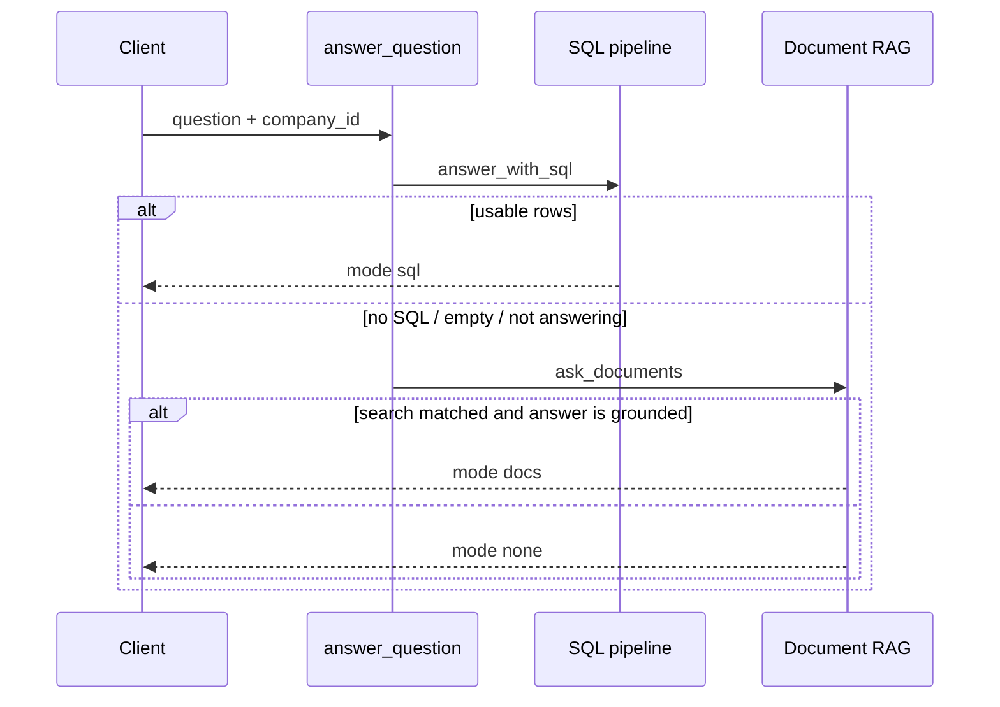

# Architecture

How `site-ai-widget` answers a question, how language is chosen, and how data is stored. Paths and names match the code in `src/site_ai_widget/`.

## Request flow

Panel `POST /ask` and public `POST /v1/widget/{key}/ask` both call `answer_question` (`ask_service.py`). `company_id` is taken from the JWT or from the widget key lookup — never from the JSON body.

Order:

1. **Small talk** — greetings / thanks (`greetings.py`) return `mode: "chat"` and skip SQL and documents.
2. **SQL** — `sqlqa.pipeline.answer_with_sql`: retrieve an approved schema slice, generate SQL with the LLM, validate with sqlglot, run on the company’s stored client DSN. Success with usable rows → `mode: "sql"` (columns, rows ≤ 500, `row_count`, `truncated`). The SQL text is never in the response. An optional LLM rephrase of the rows is checked so it cannot invent numbers (`sqlqa/present.py`); on failure the deterministic formatter is used.
3. **Documents** — if SQL is `no_sql` / `refused` / `error`, has no rows, or the presenter treats the rows as not answering the question: `docs.ask.ask_documents` (hybrid search + LLM). Hits with a grounded answer → `mode: "docs"` and `sources` from `[n]` citation markers only. A “don’t know” reply is `mode: "none"` with no chips.
4. **Unknown** — no document match, or docs failure: `mode: "none"` with a fixed visitor-facing sentence.

**Follow-ups.** Clients send the last question as `previous_question` (the widget and the Test assistant page do). When the new question is short (≤ 6 words, e.g. “E o stock?”), it is passed as context to the schema search, the SQL prompt and the document search/prompt, marked untrusted like the question. Longer questions stand alone.

**Guards on the SQL path.** A row of only NULLs (an aggregate over no matching rows) counts as empty, and `COALESCE(SUM(...), 0)` is unwrapped before running, so a filter that matched nothing never becomes a confident “0”; both lead to the no-rows retry. A text filter the model misspelt is repaired from the visitor’s own words (`merceria` → `mercearia`). SQL with a date whose year the visitor never wrote is dropped (`no_sql`), so “1 de Maio” is answered from the documents, not from a weekday guess. Refusals (“I can’t help with that”) and “not in the documents” replies become `mode: "none"`; `【n】` / `【n†…】` citation marks are rewritten to `[n]` so they map to the right page.

If every Groq key is cooling down, unified `/ask` still returns **200** with a short busy message (`notice: "busy"`), not a quota/provider error. `POST /ask/docs` still raises `llm_unavailable` **503** when the LLM cannot run.

Widget sessions: a `session_token` is issued once; only `sha256` is stored (`visitor_sessions`). History is `POST /v1/widget/{key}/history` (last 50 messages).

## Language

`reply_lang.resolve_answer_lang` is local (no extra LLM call):

1. Short utterances (`Olá`, `ok`, …) use `previous_lang`, then request `lang` / `data-lang`, then the company widget locale.
2. Longer questions: count Portuguese vs English function words (`detect_question_lang`). Accents only break a tie. Product words such as “pão” are not treated as language evidence.
3. The API returns `lang` on the answer; the widget and Test assistant send it back as `previous_lang`.

Panel UI locale is `users.panel_locale` (`pt` | `en`), separate from the visitor answer language.

## Schema retrieval and pinning

`sqlqa/retrieval.retrieve_schema` embeds the question (`intfloat/multilingual-e5-small`, 384-d) and takes up to **4** nearest **approved**, present tables (approved, present, non-sensitive columns only). A selected table's `<name>_id` columns then pull in the approved table they point to (`stock.product_id` → `products`), at most **2** extra tables, so a stock question can still name the product.

Catalog-shaped questions (“Que queijos têm?”, “Do you sell …?”) also **pin** up to **2** approved tables that have a price-like column (`price`, `preco`, `unit_price`, `valor`, `cost`, `custo`, `preço`), so product lists are not dropped in favour of stores/hours.

Table/column descriptions in the prompt are flattened and capped; they are untrusted admin/LLM text, not extra instructions.

## Answer validation

- **SQL string:** `sqlqa/validator.py` — parse with sqlglot (Postgres), forbid INSERT/UPDATE/DELETE/DDL/lock/merge, allow a fixed function set, qualify identifiers against the approved map, strip comments, enforce `LIMIT` (default 100, max 500). Sensitive columns are absent from the allowed map.
- **Execution:** `sqlqa/runner.py` re-validates, opens `client_session`, `SET TRANSACTION READ ONLY`, `statement_timeout` 5 s, lock timeout 1 s, named cursor, 500 rows / 1 MiB. SQLSTATE class **08** is a connection failure (not a generic `db_error`).
- **SQL wording:** presenter rejects invented numbers, SQL-shaped text, and currency symbols that do not match the company setting.
- **Documents:** `map_citations` only keeps `[n]` that exist in retrieved chunks. No chips when the answer does not use a source.

## Multi-tenancy

Every tenant table has `company_id`. Document chunks reference `(document_id, company_id)`. Widget keys, sessions and messages are scoped the same way. Cross-company ids are **404**, including `/ask/docs` with another company’s `document_ids`. Rate-limit buckets are per IP (and per widget key / user where noted), not a global lock on all companies except when every request shares one Docker-bridge IP (see `TRUSTED_PROXY_IPS` in `.env.example`).

## Data model and migrations

Flyway-style files in `db/migrations/`, applied by `python -m site_ai_widget.db.migrate` (Compose entrypoint, or `uv run site-ai-widget-migrate`). Versioned `Vnnn__name.sql` run once; checksums live in `schema_migrations`.

| File | Role |
|------|------|
| `V001__extensions_and_companies.sql` | `pgcrypto`, `vector`; `companies`, `users` |
| `V002__widget_keys_and_settings.sql` | `widget_keys` (`wk_%`), `widget_settings` |
| `V003__documents_and_chunks.sql` | `documents`, `document_chunks` (`vector(384)`, tsvector) |
| `V004__db_connection_and_schema.sql` | `db_connections` (Fernet DSN), `schema_tables`, `schema_columns` |
| `V005__db_connection_hardening.sql` | drop default connection status; approved rows must stay `is_present` |
| `V006__visitor_sessions.sql` | `visitor_sessions` (token hash), `visitor_messages` |
| `V007__db_connection_sslmode.sql` | `sslmode` on saved connections (`prefer` default) |
| `V008__currency_and_chat_mode.sql` | `widget_settings.currency`; message `mode` may be `chat` |
| `V009__panel_phase6c.sql` | suggestions, fullscreen, visitor PDFs, retention, panel locale, message stats |
| `V010__suggestions_manual.sql` | keep admin-typed suggestions across PDF jobs |

App DB (Compose service `db`): PostgreSQL 17 with pgvector, user `sitewidget`, database `sitewidget`, host port **5435**.

Demo **client** DB (service `clientdb`): PostgreSQL 17, database `atlas`, owner `atlas_owner`, read-only `atlas_readonly`, host port **5436**. Schema: `demo/clientdb/01_atlas_schema.sql` (categories, products, stores, opening_hours, stock, customers). Init also enables `unaccent`.
